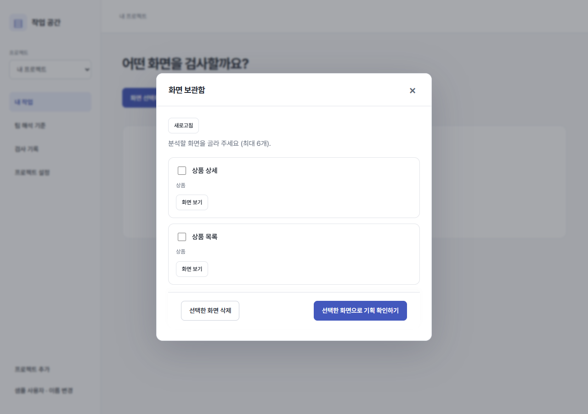
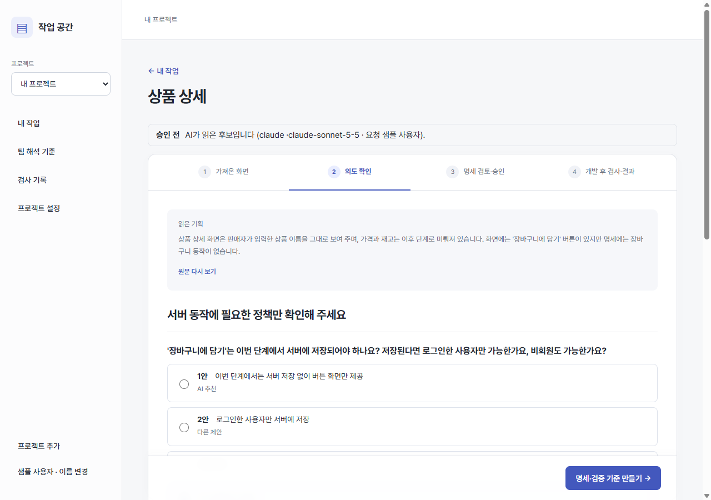
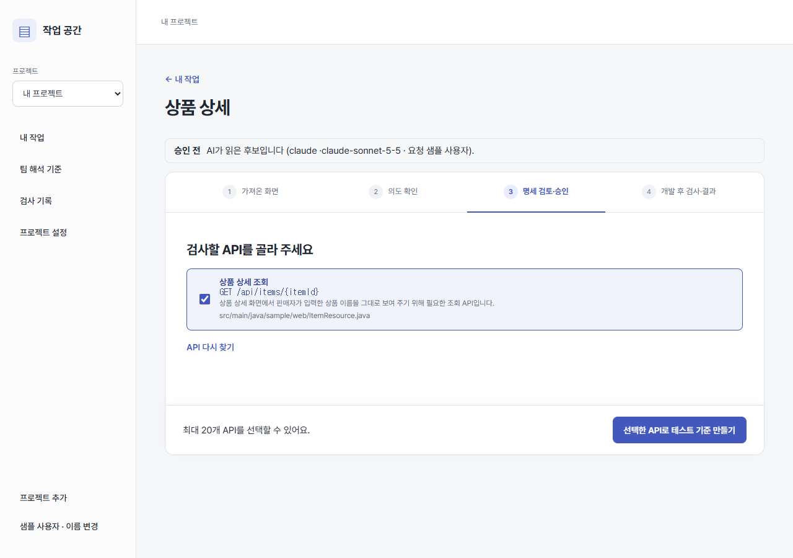
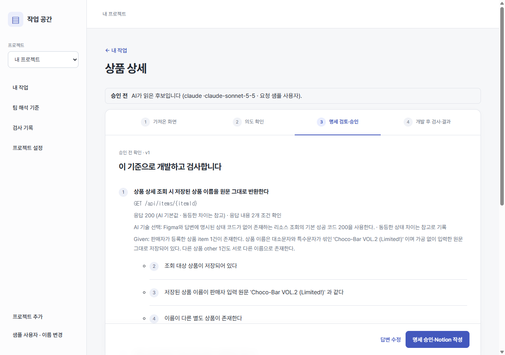
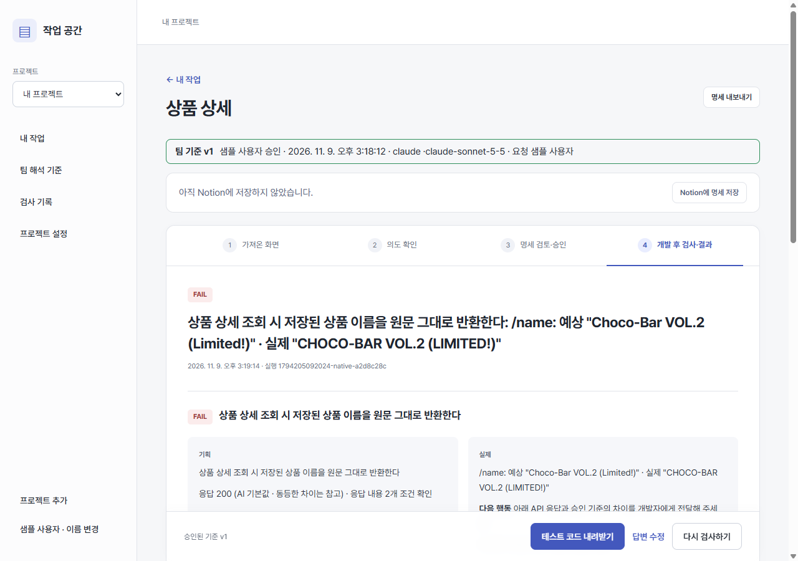

# Figma 기획 의도와 Backend 동작 검증

Figma 화면을 팀이 같은 해석으로 보게 하고, 그 해석대로 Spring Boot Backend가 실제로 동작하는지 검사하는 팀 내부 도구입니다. 제품 이름은 미정입니다.

## 문제

같은 Figma 화면을 팀원마다 다르게 읽습니다. 글자 수 표시가 서버 제한인지, 별표 없는 칸이 선택 입력인지 같은 판단이 사람마다 갈립니다. AI에게 맡겨도 호출마다 답이 달라 팀 기준이 되지 못합니다. 그렇게 갈린 해석은 프론트와 붙여 보는 통합 단계에서야 드러나고, 손으로 쓰는 API 명세는 코드와 쉽게 어긋납니다.

이 도구는 화면을 한 번 해석해 팀이 함께 승인하는 기준으로 만들고, 승인된 기준대로 Backend가 동작하는지 대상 프로젝트의 원래 빌드로 실행해 확인합니다. 사용자는 Prompt, Java 테스트, SQL, Fixture를 쓰지 않습니다.

## 동작 흐름

아래 화면은 팀과 무관한 샘플 쇼핑몰 프로젝트를 실제 앱, 실제 Claude, 실제 Gradle로 돌려서 찍었습니다.

### 1. 화면 고르기

담당자가 Figma 플러그인으로 화면을 보관함에 올려 두면 팀원은 고르기만 합니다. 정책이 Notion 기능명세서에 있으면 페이지 링크를 붙여 본문과 하위 페이지 한 단계를 같은 자격의 근거로 읽습니다.



### 2. 의도 확인

AI는 업무 결과를 바꾸는 질문만 합니다. 화면과 문서가 다르게 말하면 추측하지 않고 질문으로 올립니다. 같은 화면은 프로젝트 안에서 다시 해석하지 않고 기존 해석을 엽니다.



### 3. API 고르기

코드에서 찾은 API 후보를 화면 동작에 연결합니다. 화면에 필요한데 코드에 없는 API도 고를 수 있고, 그 API는 명세에 `시작 전`으로 남습니다.



### 4. 기준 승인

요구사항, API, Given, 검증 기준을 한 화면에서 보고 한 번 승인합니다. 승인된 내용이 팀 기준이 되고 Notion에 API 명세가 작성됩니다. Backend가 아직 없어도 여기까지는 진행됩니다.



### 5. 검사

AI는 대상 프로젝트의 `src/test`에 Given 연결 코드만 씁니다. 요청 전송, DB 관찰, 판정은 도구가 소유한 Harness가 맡습니다. Production Code와 빌드 설정은 수정하지 않고 실행 전후 해시로 확인합니다.



| 결과 | 뜻 |
| --- | --- |
| PASS | 실제 실행 결과가 기획과 일치 |
| FAIL | 실제 실행 결과가 기획과 다름 |
| BLOCKED | 준비, 인증, 관찰 실패로 판단 불가 |
| UNVERIFIED | 기준, 지원 범위, 시나리오가 없어 검사하지 않음 |

## 실제 검증 결과

실제 학생 팀 프로젝트(Spring Boot 4.1, Java 21, 단일 모듈 Gradle)의 Figma 화면 15개와 기능명세서로 분석부터 Notion 작성까지 끝까지 돌렸습니다. 질문은 원문에 답이 있을 때만 답하고 나머지는 미정으로 남겼습니다. 프로젝트 정보와 실행 기록은 공개하지 않습니다.

| PASS | FAIL | BLOCKED | UNVERIFIED | 검증한 조건 |
| ---: | ---: | ---: | ---: | ---: |
| 177 | 8 | 0 | 4 | 233 / 1006 |

PASS는 실행한 시나리오의 결과이고 원문의 조건 전체를 뜻하지 않습니다. 검증하지 못한 조건은 미정으로 남긴 질문에 달린 것과 세션 종료처럼 저장 기록으로 볼 수 없는 것들이며, 결과에 미검증으로 남습니다.

FAIL 8건을 하나씩 확인한 결과입니다.

| 분류 | 건수 | 내용 |
| --- | ---: | --- |
| 실제 불일치 | 5 | 화면의 글자 수 표시(`0/20`, `0/500`)보다 긴 값이 서버에 그대로 저장됨 |
| 테스트 데이터 문제 | 2 | 501자라던 값이 실제로는 491자였음. Given이 메일 인증 완료 상태까지 만들지 못함 |
| 테스트 기준 문제 | 1 | 기획 문구에 필수로 적힌 항목을 AI가 화면에 별표가 없다는 이유로 선택 입력으로 추론함 |

즉 8건 중 3건은 도구 쪽 오류였습니다. 실제 불일치 5건의 기준도 화면 표시에서 AI가 추론한 것이라, 서버에서도 강제할지는 팀이 정할 일입니다. UNVERIFIED 4건은 대상 프로젝트의 enum 값이 하나뿐이라 서로 다른 상태를 만들 수 없었던 경우입니다.

이 결과에 이르기까지 멀쩡한 동작을 FAIL로 판정한 원인을 여럿 고쳤습니다. 다른 파일의 enum 값을 AI가 추측해 보낸 요청, 업무 규칙에 도달하기 전의 역직렬화 실패, 실행일을 고려하지 않은 고정 날짜, 빈 목록의 비교 방식 등입니다.

가용 메모리가 약 1GB인 서버에 맞춰 줄인 수치입니다.

| 항목 | 이전 | 이후 |
| --- | ---: | ---: |
| 앱 서버 최고 메모리 (기능 65개) | 2.2GB | 159MB |
| 상태 파일 | 87.5MB | 3.8MB |
| 검사 빌드 (Linux 컨테이너, 시나리오 21개) | | 692MB, 첫 실행 822MB |

## AI 연결

프로젝트 설정에서 관리자가 기본 AI를 고릅니다. 팀원은 '내 AI'에서 자기 ChatGPT나 Claude를 연결할 수 있고, 연결하지 않으면 기본 AI로 실행됩니다.

| AI | 내 PC에서 혼자 사용 | 팀 서버에서 사용 | 확인 상태 |
| --- | --- | --- | --- |
| Codex | ChatGPT 구독 로그인 | 팀원이 자기 ChatGPT 계정을 기기 코드로 연결하면 그 팀원의 요청만 그 계정으로 실행 | 기기 코드 출력 형식 확인, 팀원 로그인 완료는 미확인 |
| Claude | Claude Code 구독 로그인 | 기본 AI는 운영자의 Anthropic API 키. 팀원은 서버 터미널의 공식 CLI로 자기 구독에 직접 로그인 가능 | 구독 경로 실제 호출 확인, API 키 경로와 서버 터미널 로그인 완료는 미확인 |
| Gemini | Google AI Studio API 키 | Google AI Studio API 키 | 응답을 흉내 낸 테스트만 통과, 실제 호출 미확인 |

구독 대신 API 키를 요구하는 이유는 제공자 약관입니다.

- **Claude:** [Anthropic 안내](https://code.claude.com/docs/en/legal-and-compliance)는 개인 요금제 자격 증명으로 다른 사용자의 요청을 대신 처리하는 것과, 앱이 로그인 코드나 토큰을 중개하는 것을 허용하지 않습니다. 그래서 기본 AI는 API 키만 쓰고, 개인 구독은 본인이 공식 CLI에 직접 로그인해 자기 요청에만 씁니다.
- **Gemini:** Gemini CLI는 [2026년 6월 18일부터 AI Pro·Ultra 요청을 처리하지 않고](https://developers.googleblog.com/an-important-update-transitioning-gemini-cli-to-antigravity-cli), 후속인 Antigravity CLI도 [개인 요금제를 다른 앱으로 감싸는 사용을 지원하지 않아](https://antigravity.google/docs/faq/) API 키 경로를 씁니다.

## 지원 범위

- Gradle wrapper가 있는 단일 모듈 Java Spring Boot 3·4·JPA 프로젝트를 지원합니다. Maven과 멀티모듈은 UNVERIFIED로 남습니다.
- 대상 프로젝트에 H2나 JUnit 실행 설정이 없어도 빌드 파일을 고치지 않고 그 실행에만 추가합니다. 로그인은 Bearer 토큰 방식을 기준으로 하고, 토큰을 만들 수 없으면 BLOCKED로 남습니다.
- H2 결과는 운영 DB 호환성의 증명이 아닙니다. 외부 제공자 실연동, Frontend 동작, 동시성은 검증하지 않습니다.
- 앱 계정은 없습니다. 비공개 링크를 아는 사람은 프로젝트에 접근할 수 있고, 이름은 표시용입니다.
- 팀 서버는 GitHub 저장소의 읽기 전용 사본을 받아 push된 커밋만 검사합니다. 대상 빌드는 키와 데이터 볼륨이 없는 별도 컨테이너에서 돌지만 OS 수준 샌드박스는 아니므로 신뢰하는 저장소만 연결합니다.

## 실행과 배포

Node.js 22 이상이 필요하고 검사에는 JDK 21과 대상 프로젝트의 Gradle wrapper가 필요합니다.

```bash
npm start
```

로컬 주소는 http://127.0.0.1:4318 입니다. 팀 서버 배포는 [HTTPS 배포 방법](docs/implementation/HTTPS-배포.md)을 따릅니다.

```bash
npm test
```

```bash
npm run prove
```

`npm run prove`는 팀 코드와 무관한 Gradle 샘플을 만들어 실제 Gradle로 PASS, FAIL, BLOCKED 판정을 확인합니다.

## 문서

- [제품 기획안](docs/source/기획안.md), [구현 규칙](docs/source/구현규칙.md)
- [Java 생성·실행 구조와 경계](docs/implementation/Java-테스트-실행.md)
- [메모리 최적화와 GitHub 코드 연결](docs/experiments/2026-11-09-서버-메모리-최적화.md), [명세서 연동과 개인 AI](docs/experiments/2026-11-08-명세서-연동과-정리.md), [다중 AI와 팀 해석](docs/experiments/2026-11-05-다중AI-팀해석.md)
